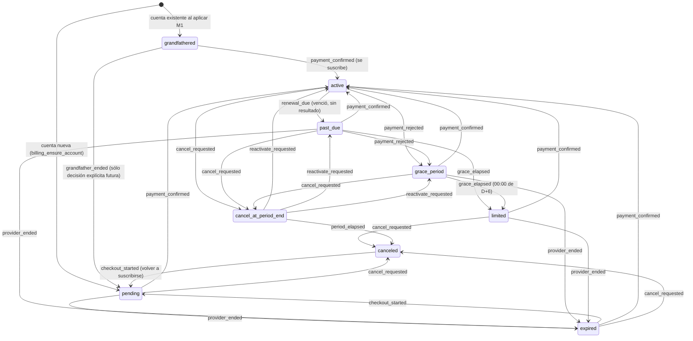

# M1 — Arquitectura y base segura de suscripciones

Estado: **implementado y probado localmente, SIN conectar, SIN aplicar y SIN desplegar.** Base: `teacherflow-web` en `7a63254` (rediseño v1 ya publicado, sin modificarlo). Rama de trabajo: `m1-billing`.

Con `BILLING_ENABLED=false` y `BILLING_ENFORCEMENT_ENABLED=false` (el estado de Production) la aplicación funciona **exactamente como hoy**: ningún archivo de `app/`, `components/` ni `proxy.ts` importa `lib/billing` (lo fija una prueba estructural), no hay rutas nuevas, no se configuró ninguna variable en Vercel, no se aplicó ninguna migración y no se cobra dinero.

Decisiones comerciales cerradas (de Joaquín): proveedor previsto Mobbex · moneda ARS · planes mensual $ 24.900, trimestral $ 69.900, semestral $ 133.900 y anual $ 249.000 · sin prueba, sin costo de alta, sin cuotas internas · cancelar conserva el acceso hasta el fin del período pagado · un pago fallido nunca borra datos · 5 días corridos de gracia · después de la gracia (cuando se habilite el control) modo limitado · cuentas actuales `grandfathered`.

## Índice

1. [Auditoría previa (M1.1)](#1-auditoría-previa-m11)
2. [Dónde se aplicará el control de acceso (sin conectarlo)](#2-dónde-se-aplicará-el-control-de-acceso-sin-conectarlo)
3. [Modelo de dominio y máquina de estados (M1.2)](#3-modelo-de-dominio-y-máquina-de-estados-m12)
4. [Catálogo de planes (M1.3)](#4-catálogo-de-planes-m13)
5. [Esquema aditivo, RLS y retención (M1.4)](#5-esquema-aditivo-rls-y-retención-m14)
6. [Adaptador del proveedor (M1.5)](#6-adaptador-del-proveedor-m15)
7. [Resolución de acceso (M1.6)](#7-resolución-de-acceso-m16)
8. [Seguridad y fallos: tabla de amenazas (M1.7)](#8-seguridad-y-fallos-tabla-de-amenazas-m17)
9. [Escala: 1.000 cuentas pagas](#9-escala-1000-cuentas-pagas)
10. [Comisión y netos estimados](#10-comisión-y-netos-estimados)
11. [Pruebas y verificación (M1.8 y M1.9)](#11-pruebas-y-verificación-m18-y-m19)
12. [Decisiones abiertas para Joaquín](#12-decisiones-abiertas-para-joaquín)
13. [Qué NO hace M1 y qué sigue (M2)](#13-qué-no-hace-m1-y-qué-sigue-m2)

---

## 1. Auditoría previa (M1.1)

Relevamiento de sólo lectura sobre el código y las migraciones de `teacherflow-web` (7/oct–13/oct/2026). No se consultó ninguna base real.

| Área | Hallazgo | Consecuencia para facturación |
|---|---|---|
| **Creación de cuenta** | `lib/auth/actions.ts` → adaptador `supabase-auth-adapter.ts` (`signUp`) con correo de confirmación y CAPTCHA opcional. **No hay ningún trigger sobre `auth.users`** en las migraciones. | No se agrega ninguno (un trigger que falle bloquearía el alta). La fila de facturación se crea **bajo demanda** (`billing_ensure_account`), y las cuentas que ya existen se rellenan en la migración. |
| **Login y confirmación** | Server Actions (`lib/auth/*`), `/auth/confirm` (verifica `token_hash`), `/auth/callback`, `/auth/confirmado`, `/auth/error`. Cookies `HttpOnly` de `@supabase/ssr`. | Sin cambios. La facturación nunca interviene en el login: un modo limitado puede ingresar. |
| **proxy.ts** | Refresca el token y **enruta**: sólo sabe si hay sesión (`getClaims`). Falla cerrado en Production sin configuración. | No es el lugar para decidir facturación (necesita la base). Ver §2. |
| **Layouts y rutas privadas** | `app/(app)/layout.tsx` repite la verificación en el servidor (`resolvePrivateAreaAccess`) y carga la identidad (`loadAccountIdentity`). Ocho carpetas privadas (`PRIVATE_ROUTE_PREFIXES`). | Es el punto natural para resolver el acceso una vez por pedido. Ver §2. |
| **`delete_own_account`** | RPC de la app móvil (`SECURITY DEFINER`): `delete from auth.users where id = auth.uid()`; todo lo propio cae por `ON DELETE CASCADE`. Irreversible. | Las tablas de facturación nacen con `ON DELETE CASCADE` hacia la cuenta; avisos y anomalías (sin datos personales) sólo pierden la referencia. **Pendiente (M2):** el flujo de eliminación debe cancelar antes la suscripción en el proveedor. Ver §12. |
| **Tablas con `owner_id`** | 37 de las 39 tablas de las migraciones iniciales llevan `owner_id uuid references auth.users on delete cascade` (+ importaciones, cuotas y avisos de R3/R6). Políticas `*_owner_all` (`owner_id = auth.uid()`), pasadas a `TO authenticated` en R5. `anon` sin privilegios. | Las tablas nuevas siguen el mismo patrón, pero **más cerrado**: lectura propia sólo de estado y períodos; escritura sólo del servidor. |
| **RLS y alcance directo** | 24 tablas aceptan `INSERT` directo de `authenticated` por PostgREST (R3 §1.2). Las cuotas viven en triggers de tabla **porque** el navegador puede saltearse la web. | El control de acceso futuro también necesita una capa en la base (§2, punto 4); una pantalla bloqueada no alcanza. |
| **`service_role`** | **Ningún** archivo del repo la usa (la web sólo usa la clave publicable; `lib/auth/config.ts` y su prueba lo fijan). R3 dejó la clave de servicio como decisión del propietario. | La facturación **la necesita** (los avisos del proveedor llegan sin sesión de persona). Queda confinada a un único módulo (`lib/billing/supabase-store.ts`), a funciones `billing_*` ejecutables sólo por `service_role`, y **no está configurada**. Es la primera decisión abierta (§12). |
| **Server Actions** | Siete archivos en `lib/actions/`: todos resuelven `ownerId` con `requireAuthenticatedDbContext()` (sesión real), nunca del navegador, y devuelven errores por `actionErrorMessage`. | Los comandos de facturación siguen el mismo principio (`ownerId` de la sesión; el navegador sólo manda un código de plan del catálogo). |
| **Variables de Vercel** | Públicas: `NEXT_PUBLIC_SUPABASE_URL`, `NEXT_PUBLIC_SUPABASE_PUBLISHABLE_KEY`, `NEXT_PUBLIC_SITE_URL`, `NEXT_PUBLIC_TURNSTILE_SITE_KEY` (opcional). Servidor: `RECOVERY_MARKER_SECRET` (+ `_PREVIOUS`). Existen `RESEND_*` en Vercel que el código no usa. | Variables nuevas, todas **sólo de servidor** y **no configuradas**: `BILLING_ENABLED`, `BILLING_ENFORCEMENT_ENABLED`, `MOBBEX_API_KEY`, `MOBBEX_ACCESS_TOKEN`, `MOBBEX_SANDBOX`, `MOBBEX_SUBSCRIPTION_UID_*`, `SUPABASE_SERVICE_ROLE_KEY`. Documentadas (sin valores) en `.env.example`. |
| **Rutas públicas** | `/`, `/login`, `/crear-cuenta`, `/recuperar-contrasena`, `/nueva-contrasena`, `/iniciando-sesion`, `/auth/*`, manifest e íconos. | M1 no agrega ninguna. En M2 la recepción de avisos será la única ruta pública nueva (cerrada con interruptor: 404 si la facturación está apagada). |
| **Errores y logs** | `actionErrorMessage` (texto seguro) + una línea `[action-error]` con categoría y código; guardas contra `error.message` en Server Actions; nunca PII. | La facturación tiene su propio registro cerrado (`lib/billing/log.ts`: lista fija de campos y valores que sólo pueden ser códigos) y sus propios mensajes (`safe-errors.ts`). |
| **Retención y exportación** | R4: purga de importaciones vencidas y reautenticación; respaldos en la nube de la app móvil (`cloud_backups`, 10 por cuenta). **La web no tiene una acción de exportar datos.** | La retención de avisos (90 días) y de anomalías resueltas (1 año) está definida y probada. La capacidad `exportData` existe en el modo limitado (siempre permitida), pero **la función de exportar en la web todavía no existe**: es un requisito previo de M3 (§13). |

## 2. Dónde se aplicará el control de acceso (sin conectarlo)

`resolveBillingAccess` (`lib/billing/access.ts`) está terminada y probada, pero **no la llama nadie**. Cuando se decida conectarla (M3, con `BILLING_ENFORCEMENT_ENABLED=true`):

| # | Punto | Qué hace | Por qué ahí |
|---|---|---|---|
| 1 | `app/(app)/layout.tsx` (Server Component, ya corre en cada pedido privado) | Lee el estado de la cuenta (`loadBillingSnapshot`), resuelve `BillingAccess` y se lo pasa al shell: aviso de gracia, banner de modo limitado. | Una sola lectura por pedido, junto a `loadAccountIdentity`. |
| 2 | Server Actions de escritura (`lib/actions/*.ts`) | Un único guardián `requireWritableContext()` (sobre `requireAuthenticatedDbContext`) que rechaza con `access.capabilities.createOperationalData/modifyOperationalData === false` y un mensaje claro. | Es donde nacen las escrituras de la web. |
| 3 | Pantallas | Ocultan o deshabilitan botones de alta/edición según `capabilities` (nunca por color solo). | Experiencia: que nadie pulse algo que va a fallar. |
| 4 | **Base de datos** (futuro) | Triggers `BEFORE INSERT/UPDATE` en las tablas operativas que llamen a `billing_is_writable(auth.uid())`, siguiendo el modelo de las cuotas de R3. | 24 tablas aceptan escrituras directas por PostgREST: el modo limitado **no puede** depender sólo de la web. |
| 5 | `/facturacion` (ruta nueva, M2) | Siempre accesible (ver, cancelar, actualizar medio de pago). | Es lo que el modo limitado debe poder hacer. |
| 6 | Exportar datos y eliminar cuenta | Siempre permitidos, también en modo limitado. | Derecho de la persona; además evita que la facturación retenga datos. |
| ✗ | `proxy.ts` | **No** decide facturación. | Sólo conoce la sesión; consultar la base en cada navegación sumaría latencia y un punto de falla. |

Una prueba estructural (`billing-structure.test.ts`) falla si algún archivo de `app/`, `components/` o `proxy.ts` importa `lib/billing`: conectarlo exigirá cambiar esa prueba **a propósito**.

## 3. Modelo de dominio y máquina de estados (M1.2)

### 3.1 Principios

* **El navegador nunca decide si una cuenta está paga.** Sólo pide acciones (cancelar, elegir un plan del catálogo); el servidor resuelve todo.
* **Volver de Mobbex no activa nada.** Sólo un cobro **verificado y conciliado** activa o renueva.
* **Los avisos llegan duplicados, desordenados y demorados**, así que el estado **se deriva del conjunto de cobros**, no del orden de llegada (`lib/billing/ledger.ts`): un aviso viejo se ubica donde le corresponde y nunca pisa un estado más nuevo; repetir un cobro no cambia nada.
* **La máquina de estados valida lo derivado** (`lib/billing/state-machine.ts`): si el estado calculado no es alcanzable desde el guardado por transiciones permitidas, **no se aplica** y se registra una anomalía de conciliación.
* **Fechas civiles de Argentina** (`America/Argentina/Buenos_Aires`, utilidades existentes del calendario): nunca `new Date().toISOString().slice(0, 10)`. Un período pagado es `[inicio, fin)`: empieza a las 00:00 del día civil del vencimiento y termina a las 00:00 del mismo día `N` meses después (31/01 + 1 mes = 28/02 o 29/02).
* **Gracia:** el vencimiento rechazado cae el día civil `D`; los días `D+1` a `D+5` completos son gracia; el modo limitado empieza a las **00:00 de `D+6`**.

### 3.2 Diagrama de estados

Los bucles (repetir `payment_confirmed` en `active`, `cancel_requested` en `canceled`, `payment_rejected` en `pending`, `checkout_started` en `pending`/`grandfathered`, `plan_change_requested` en `active`…) son **repeticiones válidas e idempotentes**: no cambian el estado.

### 3.3 Significado de cada estado y acceso

| Estado | Cuándo | Acceso (con control encendido) |
|---|---|---|
| `grandfathered` | Cuenta existente al aplicar M1, sin cobro. | Completo. |
| `pending` | Cuenta nueva (o que vuelve a suscribirse) sin cobro confirmado. | **Limitado** → acción: suscribirse. |
| `active` | Período pagado vigente. | Completo. |
| `past_due` | Venció el período y todavía no hay resultado confirmado del cobro (demora de avisos o del proveedor). | Completo (acción: esperar). |
| `grace_period` | El cobro de renovación fue **rechazado**: 5 días corridos. | Completo **con aviso** → acción: actualizar el medio de pago. |
| `limited` | Terminó la gracia sin pago. | **Limitado** (sin perder datos). |
| `cancel_at_period_end` | La persona canceló: conserva el acceso hasta el fin de lo pagado (sin renovación ni gracia). | Completo **con aviso** → acción: reactivar. |
| `canceled` | Terminó lo pagado tras cancelar, o canceló sin período vigente. | **Limitado** → acción: volver a suscribirse. |
| `expired` | El proveedor dio por terminada la suscripción sin que la persona cancelara. | **Limitado** (completo hasta el fin de lo ya pagado) → acción: volver a suscribirse. |

**Modo limitado:** puede ingresar, ver sus datos, ver la facturación, cancelar, actualizar el medio de pago, **exportar** y **eliminar la cuenta**; no crea ni modifica datos operativos. Nunca borra ni oculta datos.

### 3.4 Transiciones permitidas (fuente: `TRANSITIONS`)

Toda combinación estado × disparador **que no figura es imposible y se rechaza** (`impossible_transition`); la prueba compara la tabla del código contra una lista escrita a mano de las 45 transiciones válidas (43 pares estado × disparador, porque reactivar tiene tres destinos) y comprueba que los otros 56 pares de los 99 posibles (9 estados × 11 disparadores) se rechazan.

| Desde | Disparadores → destino |
|---|---|
| `grandfathered` | `payment_confirmed`→active · `checkout_started`→grandfathered · `grandfather_ended`→pending |
| `pending` | `payment_confirmed`→active · `payment_rejected`→pending · `checkout_started`→pending · `cancel_requested`→canceled · `provider_ended`→expired |
| `active` | `renewal_due`→past_due · `payment_confirmed`→active · `payment_rejected`→grace_period · `cancel_requested`→cancel_at_period_end · `plan_change_requested`→active · `provider_ended`→active |
| `past_due` | `payment_confirmed`→active · `payment_rejected`→grace_period · `grace_elapsed`→limited · `cancel_requested`→cancel_at_period_end · `provider_ended`→expired |
| `grace_period` | `payment_confirmed`→active · `payment_rejected`→grace_period · `grace_elapsed`→limited · `cancel_requested`→cancel_at_period_end · `provider_ended`→expired |
| `limited` | `payment_confirmed`→active · `payment_rejected`→limited · `cancel_requested`→canceled · `provider_ended`→expired |
| `cancel_at_period_end` | `period_elapsed`→canceled · `reactivate_requested`→active/past_due/grace_period · `cancel_requested`→cancel_at_period_end · `payment_confirmed`→cancel_at_period_end · `payment_rejected`→cancel_at_period_end · `provider_ended`→cancel_at_period_end |
| `canceled` | `checkout_started`→pending · `cancel_requested`→canceled · `payment_rejected`→canceled · `provider_ended`→canceled |
| `expired` | `payment_confirmed`→active · `checkout_started`→pending · `cancel_requested`→canceled · `payment_rejected`→expired · `provider_ended`→expired |

Imposibles que protegen reglas de negocio (todas probadas): un cobro suelto **no revive** una cuenta cancelada; **no se abre otro checkout** con una suscripción en curso (no duplica suscripciones); **cambiar de plan sólo con la suscripción activa**; `grandfathered` no se bloquea por reloj ni por rechazos.

### 3.5 Reglas de negocio implementadas

| Regla | Dónde |
|---|---|
| Un cobro cuenta **una sola vez** (clave única `(proveedor, ejecución)`); repetirlo, o reprocesarlo, no cambia nada. | `billing_executions`/`billing_periods` únicos + `finalOutcomes` |
| Un resultado viejo no pisa a uno nuevo; a igual instante gana `approved`. | `finalOutcomes` + `billing_commit_batch` |
| Cancelar **no borra historial** y conserva el acceso hasta el fin de lo pagado. | `decideCancel`, `cancelAccessEnd` |
| Cancelar repetido es idempotente (no vuelve a escribir ni a llamar al proveedor). | `decideCancel` + `billing_plan_changes` único |
| **Cambiar de plan no duplica suscripciones**: sólo `active`, rige desde el **próximo período** (sin prorrateo ni crédito), uno solo programado por cuenta. | `decidePlanChange` + índice único parcial |
| Pago aprobado **después de cancelar**: se registra el cobro (el dinero no se pierde), se informa la anomalía `paid_after_cancel` y **no** revive una cuenta ya cancelada. | `reduceSnapshot` |
| Importes, moneda y plan se validan **siempre** contra el catálogo del servidor (y de nuevo contra el espejo en la base). | `validateAgainstCatalog`, trigger `billing_check_amount_vs_catalog` |
| Ni precio, plan, período, `owner_id` ni estado salen del navegador ni del aviso: la propietaria sale de **nuestra** referencia (`tfs_…`), el importe del catálogo y el estado del libro de cobros. | `reconcileOperation` |
| El dinero lo decide la **consulta autenticada al proveedor**, no el cuerpo del aviso. | `processEventBatch` |
| Un redirect de Mobbex nunca activa: sólo un cobro verificado y conciliado. | `startCheckout` (no escribe estado) |

## 4. Catálogo de planes (M1.3)

Fuente única: `lib/billing/plans.ts` (inmutable, con prueba de que no se puede alterar). La interfaz recibe los precios ya resueltos del servidor (`listPublicPlans`); **ninguna pantalla duplica un precio** (una prueba escanea `app/`, `components/` y el resto de `lib/`).

| Código | Nombre | Moneda | Precio (centavos) | Intervalo | Meses de acceso | Intervalo en Mobbex | Versión |
|---|---|---|---:|---|---:|---|---:|
| `tf_monthly_ars_v1` | Mensual | ARS | 2.490.000 ($ 24.900) | 1 mes | 1 | `1m` | 1 |
| `tf_quarterly_ars_v1` | Trimestral | ARS | 6.990.000 ($ 69.900) | 3 meses | 3 | `3m` | 1 |
| `tf_semiannual_ars_v1` | Semestral | ARS | 13.390.000 ($ 133.900) | 6 meses | 6 | `6m` | 1 |
| `tf_annual_ars_v1` | Anual | ARS | 24.900.000 ($ 249.000) | 12 meses | 12 | `1y` | 1 |

* Importes **enteros en centavos** (nunca coma flotante); las conversiones a decimal (`24900.00`) y desde él se hacen con aritmética entera y rechazan más de dos decimales.
* Un cambio de precio es un **código nuevo** (`..._v2`), nunca la edición del vigente.
* El espejo SQL `billing_plans` se siembra con los mismos valores; una prueba compara código, importe, intervalo y versión contra el catálogo del servidor, y otra (contra Postgres real) lo vuelve a comprobar sobre la base.

## 5. Esquema aditivo, RLS y retención (M1.4)

Dos migraciones **locales, sin aplicar** (`supabase/migrations/20261014100000_m1_billing_core.sql`, `…110000_m1_billing_functions.sql`), aditivas e idempotentes (se aplican dos veces sin error y sin duplicar nada; sólo crean objetos `billing_*`) y un script de rollback (`supabase/repairs/m1_billing_rollback.sql`, sólo `billing_*`).

| Tabla | Para qué | Claves e integridad |
|---|---|---|
| `billing_plans` | Espejo del catálogo. | `code` PK; `months_of_access = interval_months`; sólo ARS. |
| `billing_settings` | Corte de «cuentas actuales» (`grandfather_cutoff`, fijado al aplicar). | Singleton. |
| `billing_subscriptions` | **Suscripción actual** de cada propietaria (una fila) con estado, plan, plan programado, período, gracia, cancelación, `restarted_at`, `next_check_at`, `version`. | PK `owner_id` → `auth.users` cascade; `provider_reference` y `provider_subscriber_uid` **únicos**; check de que un estado con período pagado tiene período y plan; trigger: un estado pago exige un **período registrado** que termine donde dice la suscripción; trigger: toda escritura sube la versión en uno. |
| `billing_periods` | **Historial de períodos** pagados (una fila por ejecución aprobada). | Único `(proveedor, ejecución)`; trigger de catálogo; propietaria inmutable. |
| `billing_executions` | **Cobros informados por el proveedor** (aprobado/rechazado), con vencimiento y momento. | Único `(proveedor, ejecución)`; trigger de catálogo; propietaria inmutable. |
| `billing_checkout_attempts` | **Intentos de checkout** (plan, precio y versión fijados por el servidor). | Único `(owner, idempotency_key)`; **un solo intento abierto** por cuenta (índice parcial); trigger de catálogo. |
| `billing_plan_changes` | **Cambios de plan, cancelaciones y reactivaciones** (historial; nada se borra). | Único `(owner, idempotency_key)`; **un solo cambio de plan programado** (índice parcial). |
| `billing_webhook_events` | **Avisos idempotentes**: identidad semántica (`dedup_key`), tipo, hash del cuerpo, campos **normalizados** (≤ 4 KB), estado, intentos, arrendamiento, `purge_after`. | `dedup_key` único; **sin cuerpo crudo**; retención 90 días. |
| `billing_reconciliations` | **Conciliación**: toda anomalía (referencia desconocida, importe/moneda/plan que no cierran, pago tras cancelar, reembolso, transición imposible, proveedor caído). | Una abierta por `dedupe_key`; detalle ≤ 1 KB. |
| `billing_sweep_cursors` | Cursor del barrido periódico contra el proveedor. | PK `name`. |

**Referencias externas únicas:** `provider_reference`, `provider_subscriber_uid`, `(provider, execution_uid)` en cobros y períodos, `dedup_key` en avisos, `provider_checkout_uid` por intento.

**Timestamps:** período (`current_period_start/end`), gracia (`grace_ends_at`, `renewal_rejected_due_at`), cancelación (`cancel_requested_at`), reinicio (`restarted_at`), fin del proveedor (`provider_ended_at`), próxima revisión (`next_check_at`), más `created_at`/`updated_at`.

**No se guarda** (y una prueba lo verifica sobre cada columna del esquema): números de tarjeta, CVC, datos bancarios, tokens de tarjeta, secretos, correos, nombres, documentos, teléfonos ni payloads crudos. De un aviso sólo se conservan identificadores, importes, moneda, estado, fechas y un hash, con retención definida (`billing_purge_retention`: avisos resueltos a 90 días, anomalías resueltas a 1 año; los cobros y períodos se conservan mientras exista la cuenta).

### 5.1 RLS y privilegios

| Rol | Qué puede |
|---|---|
| `anon` | **Nada** (ni tablas ni funciones). |
| `authenticated` | **Leer** su propia fila de `billing_subscriptions` (columnas: estado, plan, plan programado, período, gracia, cancelación…, **sin** `provider_reference`, `provider_subscriber_uid`, `next_check_at`, `version`) y sus propios `billing_periods`. Nada más: ni escribir, ni leer otras tablas, ni ejecutar funciones, ni `select *` (la web pide columnas explícitas). |
| `service_role` | Todo (la única vía de escritura) — **sólo desde `lib/billing/supabase-store.ts`**, y sólo mediante funciones `billing_*`. |

Probado con dos propietarias: cada una ve sólo lo suyo (tanto por RLS como por privilegios de columna); ninguna puede activar, pagar, conciliar ni editar una suscripción (UPDATE/INSERT/DELETE directos rechazados, incluso sobre la propia).

### 5.2 Funciones SQL (todas de servidor)

`INVOKER`, `search_path = ''` y `EXECUTE` sólo para `service_role` (una excepción: `billing_ensure_account` es `SECURITY DEFINER` porque lee `auth.users.created_at`, al que `service_role` no tiene por qué acceder). La lógica del estado **no** está en SQL (vive en `lib/billing`, pura y probada): la base garantiza integridad (versión, unicidad, catálogo, atomicidad por lote). Un diferencial prueba que el SQL de `billing_open_checkout_attempt` y la máquina de estados del servidor permiten abrir un checkout en **los mismos estados**.

| Función | Para qué |
|---|---|
| `billing_ensure_account` | Crea bajo demanda la fila (grandfathered si ya existía al corte; pending si es nueva). |
| `billing_get_subscriptions`, `billing_resolve_subscribers`, `billing_owner_executions`, `billing_due_subscriptions` | Lecturas **por lotes** (arreglos), paginadas por cursor. |
| `billing_ingest_webhook_events` | Recepción idempotente (descarta duplicados por `dedup_key`). |
| `billing_claim_events` | Reclamo por lotes con arrendamiento y `FOR UPDATE SKIP LOCKED`; recupera los arrendamientos vencidos. |
| `billing_commit_batch` | Escritura **atómica por lote** (cobros, períodos, suscripciones con control optimista, cambios, anomalías, resultado de los avisos). |
| `billing_open_checkout_attempt`, `billing_complete_checkout_attempt`, `billing_fail_checkout_attempt` | Checkout atómico: precio releído del catálogo de la base, un solo intento vivo por cuenta. |
| `billing_sweep_cursor_get/set`, `billing_purge_retention` | Barrido periódico y retención. |

## 6. Adaptador del proveedor (M1.5)

Interfaz `ProviderAdapter` (`lib/billing/provider.ts`), desacoplada de Mobbex: `createCheckout`, `getOperation` (consulta **autenticada**, fuente de verdad del dinero), `listOperations` (barrido paginado), `cancelSubscriber`, `reactivateSubscriber`, `changePlan` y `verifyWebhook`. Ningún método lanza: devuelve `ProviderResult`; los errores sólo tienen **categoría** (`not_configured`, `unauthorized`, `timeout`, `unavailable`, `rejected`, `invalid_response`, `unsupported`), nunca cuerpos, encabezados ni claves.

* **Adaptador falso determinista** (`providers/fake.ts`, sólo pruebas): checkout idempotente por clave, inyección de fallas (caída, timeout, rechazo), barrido paginado y verificación de avisos con **HMAC-SHA256 de prueba** (un doble de prueba; **no** es el mecanismo de Mobbex).
* **Esqueleto cerrado de Mobbex** (`providers/mobbex.ts`): prepara pedidos, tipos y validadores **según la documentación oficial** y no hace **ninguna llamada de red sin credenciales** (`MOBBEX_API_KEY`, `MOBBEX_ACCESS_TOKEN`: sólo servidor; sin prefijo `NEXT_PUBLIC_`).

### 6.1 Qué documenta Mobbex (consultado el 13–14/oct/2026 en `mobbex.dev`) y qué no

| Tema | Documentado | Uso en el esqueleto |
|---|---|---|
| Autenticación de la API | Encabezados `x-api-key` y `x-access-token` (más `content-type: application/json`). Credenciales de la consola/portal de desarrolladores. | Sólo servidor; nunca se registran. |
| Suscripciones | `POST /p/subscriptions`: `total` (decimal con punto), `currency` (**sólo ARS**), `type` (`dynamic` o `manual`), `interval` (`7d`, `15d`, `1m`, `2m`, `3m`, `6m`, `1y`), `limit` (0 = ilimitado), `trial`, `setupFee`, `reference` única, `return_url` y `webhook` (HTTPS), `test`. El intervalo sólo se edita si no hay suscriptores. | Una suscripción **dinámica por plan** (`reference` = código del plan): `1m`, `3m`, `6m`, `1y`; `trial = 0`, `setupFee = 0`, `limit = 0`. |
| Suscriptores | `POST /p/subscriptions/{id}/subscriber` (`customer.email/name/identification` **obligatorios**, `startDate` ≥ 1 día después de hoy, `reference` única, `test`) → `sourceUrl` (dónde cargar la tarjeta). Suspender, reactivar, borrar, **mover a otra suscripción** (recalcula la agenda). | Cancelar = `suspend`; reactivar = `activate`; cambiar de plan = `move`. `startDate` = mañana (fecha civil de Argentina). La redirección sólo se acepta si es HTTPS de `mobbex.com`. |
| Consulta de una operación | `POST /2.0/transactions/status` (multipart, `id`) con `data.transaction.payment` (`id`, `status.code`, `total`, `currency.code`, fechas, `reference`). | `getOperation`. Es **la verdad del dinero**. |
| Estados | Tabla de códigos (200 Paga, 201 Aceptada, 400–419 declinada/denegada, 600–610 cancelada/devuelta…). | Traducción **conservadora**: sólo 200 y sus etapas de liquidación (299–303) cuentan como cobro aprobado; 201 (validada) no es cobro. |
| Avisos (webhooks) | Tipos: `subscription:execution`, `:registration`, `:change_source`, `:subscriber:suspended`, `:subscriber:active`, `checkout`. Cuerpo con `payment`, `execution`, `subscription`, `subscriber`, `customer`, `source`. Reintentos, TLS ≥ 1.2. **El aviso trae sólo `Content-Type`.** Una página dice JSON y otra `application/x-www-form-urlencoded`: se aceptan ambas. | Se normaliza a campos no sensibles (sin `customer`, `source`, tarjeta). |
| **Autenticación / firma de avisos** | **NO está documentada.** No hay firma, secreto ni encabezado de verificación en ninguna página consultada. | **El adaptador real RECHAZA SIEMPRE** (`mechanism_not_documented`): jamás se acepta, guarda ni procesa un aviso sin verificar. Una prueba lo fija aunque el cuerpo y los encabezados parezcan válidos. |
| Listado de ejecuciones de un suscriptor; identidad del suscriptor en el listado de operaciones | La documentación muestra respuesta vacía (`{}`) o no incluye identificadores de suscriptor/ejecución. | `listOperations` devuelve `unsupported`: **no se inventa un formato**. |

Consecuencia (decisión abierta §12): con Mobbex tal como está documentado, los avisos **no se pueden autenticar**. M2 debe resolverlo con evidencia: consultar a Mobbex por un mecanismo de verificación o aprobar explícitamente una alternativa (p. ej. usar el aviso sólo como *disparador* de una consulta autenticada, o sondeo periódico por suscriptor). El diseño ya soporta ambas: el dinero siempre sale de la consulta autenticada (`getOperation`), nunca del cuerpo del aviso.

Mientras `listOperations` esté sin soporte en el adaptador real, **un aviso de estado final que se pierda no se recupera por el barrido global** (la documentación del listado no trae la identidad del suscriptor). El barrido ya está construido, paginado y probado con el adaptador falso; para Mobbex M2 debe agregar el sondeo **por suscriptor** (`GET …/subscriber/{sid}`, cuya respuesta de ejecuciones la documentación hoy muestra vacía) y validarlo en sandbox.

### 6.2 Datos personales que exige la API de Mobbex

Crear un suscriptor exige `customer.email`, `name` e **`identification` (DNI/CUIT)**. TeacherFlow no los tiene todos hoy. M1 los modela sólo como **dato de paso** (`ProviderCustomer`: viaja al proveedor y no se guarda ni se registra; una prueba lo verifica). Cómo capturarlos (en el checkout de TeacherFlow o en el formulario de Mobbex) es una decisión de producto/privacidad para M2 (§12).

## 7. Resolución de acceso (M1.6)

`resolveBillingAccess({ flags, snapshot, now })` → `{ level (full | full_with_notice | limited), reason (código seguro), nextAction, endsAt, status, capabilities }`.

* Con `BILLING_ENABLED` o `BILLING_ENFORCEMENT_ENABLED` apagados devuelve **siempre** acceso completo (`enforcement_off`) para cualquier estado y fecha — equivalente al comportamiento actual (probado con todos los estados × tres fechas × las tres combinaciones de interruptores apagados).
* **No confía en la etiqueta guardada:** reproyecta el estado con el reloj (una cuenta «active» vencida hace meses está limitada aunque el barrido todavía no la haya tocado).
* Sin estado conocido (sin fila, base caída o fecha inválida) con el control encendido: **acceso completo** con motivo `billing_state_unavailable`. Una falla de Supabase nunca bloquea a una profesora que paga; sí **falla cerrado** cualquier *cambio* de facturación (§12, decisión 4).
* Capacidades (`AccessCapabilities`): en modo limitado `viewOperationalData`, `viewBilling`, `cancelSubscription`, `updatePaymentMethod`, `exportData` y `deleteAccount` son verdaderas; `createOperationalData` y `modifyOperationalData`, falsas.
* Los interruptores se leen sólo del entorno del servidor (`lib/billing/flags.ts`): sólo el texto exacto `true` enciende; `BILLING_ENFORCEMENT_ENABLED` sin `BILLING_ENABLED` se trata como apagado.

## 8. Seguridad y fallos: tabla de amenazas (M1.7)

Principio: **ante la duda, fallar cerrado para cambios de facturación; no bloquear la aplicación actual mientras el control esté apagado.** Los errores visibles son frases claras (`safe-errors.ts`) y nunca muestran secretos, payloads, códigos internos, SQL, restricciones ni respuestas crudas del proveedor.

| # | Amenaza / fallo | Defensa | Prueba |
|---|---|---|---|
| 1 | **Webhook duplicado** | Identidad semántica (`dedup_key` = hash de tipo + pago + estado + actualización + ejecución + suscriptor); ingesta idempotente; cobro único por ejecución. | webhook-ingest 5; DB 4.1, 5.2; escala (3.000 duplicados) |
| 2 | **Webhook fuera de orden** | El estado se deriva del **conjunto** de cobros; el resultado más reciente de cada ejecución gana. | ledger (todas las permutaciones + 200 barajados); DB 5.3 (lotes de a uno) |
| 3 | **Webhook falso / firma inválida / ausente** | `verifyWebhook` obligatorio antes de guardar; 401 sin tocar la base; Mobbex real: cerrado. | webhook-ingest 3, 9; DB 5.4 |
| 4 | **Referencia desconocida** | Se resuelve contra nuestra base; si no existe → anomalía `unknown_reference`, ninguna cuenta cambia. | reconcile; DB 5.4; escala (500 desconocidas) |
| 5 | **Importe incorrecto** | `validateAgainstCatalog` (entero exacto) + trigger contra `billing_plans`. | plans-money; reconcile; DB 2.1, 5.5 |
| 6 | **Moneda distinta de ARS** | Validación + `check (currency = 'ARS')` + trigger; operaciones de prueba (`TEST`) ignoradas en Production. | idem |
| 7 | **Plan manipulado** | Sólo códigos del catálogo; el plan del cobro debe estar entre los de **esa** cuenta (vigente, programado, intento reciente). | reconcile; commands; DB 3.2, 5.5 |
| 8 | **`owner_id` ajeno / suscriptor cruzado** | La propietaria sale de **nuestra** referencia opaca (`tfs_…`); si el aviso y la operación discrepan → `owner_mismatch`; ninguna se acredita. Las ejecuciones nunca cambian de propietaria (trigger). | reconcile; DB 2.4, 5.6 |
| 9 | **El aviso dice «aprobado» pero el proveedor dice «rechazado»** | El dinero lo decide la consulta autenticada (`getOperation`), no el cuerpo. | DB 5.17 |
| 10 | **Respuesta perdida / proceso que muere** | Arrendamiento con vencimiento; el lote vuelve a la cola; reproceso idempotente. | DB 4.2, 5.9; escala (trabajador muerto) |
| 11 | **Timeout / caída de Mobbex** | Reintentos con espera exponencial (tope 1 h) y `dead` tras el máximo, con anomalía `provider_unreachable`; nada se pierde. | DB 5.8 |
| 12 | **Caída de Supabase** | Recepción: 503 (el proveedor reintenta); comandos: fallan cerrado con un mensaje claro y sin cambios; resolución de acceso: completo (no bloquea). | webhook-ingest; commands; access |
| 13 | **Checkout duplicado / dos pestañas** | Un solo intento vivo por cuenta (índice parcial + bloqueo de fila); la misma clave devuelve el mismo intento; al proveedor se le envía siempre la clave del intento original. | commands; DB 3.3 (10 conexiones simultáneas) |
| 14 | **Cambio de plan concurrente** | Control optimista de versión + un solo cambio programado (índice parcial). | commands; DB 5.11 |
| 15 | **Cancelación repetida / concurrente** | Idempotente; un solo registro. | commands; DB 5.11 |
| 16 | **Pago aprobado después de cancelar** | Se registra el cobro, se informa `paid_after_cancel`, no se revive la cuenta. | ledger; DB 5.7 |
| 17 | **Dos trabajadores sobre la misma cuenta** | Control optimista de versión; los avisos de una cuenta en conflicto vuelven a la cola. | DB 5.10; escala |
| 18 | **Activar sin pago** | Trigger: un estado pago exige un período registrado que lo respalde; sin cobro aprobado no hay período. | DB 2.2 |
| 19 | **Navegador que escribe su suscripción o la de otra** | RLS + privilegios por columna: ni UPDATE ni INSERT; lectura sólo de lo propio. | DB 1.3–1.5 |
| 20 | **Credenciales en el navegador / en logs** | Sin `NEXT_PUBLIC_` para secretos; un solo módulo lee cada clave; registro de lista cerrada; build sin credenciales en el bundle. | billing-structure; log |
| 21 | **Datos personales en la base o en los logs** | Sólo campos normalizados; ninguna columna sensible; `normalized` ≤ 4 KB. | billing-structure; webhook-ingest 2 |
| 22 | **Prototype pollution / cuerpo gigante** | Claves peligrosas ignoradas; tope de 64 KB antes de verificar. | webhook-ingest |
| 23 | **Redirección maliciosa** | Sólo HTTPS de `mobbex.com`; `redirect: "error"` en el cliente HTTP. | mobbex-adapter |
| 24 | **Flags apagados** | La recepción responde 404, los comandos rechazan y el acceso es completo; nada se conecta. | access; commands; DB 5.16; billing-structure |
| 25 | **Cuenta existente bloqueada por error** | `grandfathered` sin camino automático a otro estado; el barrido del reloj no la toca. | state-machine; DB 5.14 |
| 26 | **Retención indefinida de payloads** | Sin cuerpo crudo; `purge_after` a 90 días; purga por lotes que no toca avisos pendientes ni en proceso. | DB 2.6, 5.15 |

## 9. Escala: 1.000 cuentas pagas

Requisito técnico (no una proyección comercial ni fiscal): soportar **al menos 1.000 cuentas pagas activas** sin asumir que cobran o renuevan en momentos distintos. Con el stack actual (Supabase + Vercel + procesamiento por lotes); **sin infraestructura nueva**.

Diseño:

* **Recibir rápido, trabajar después.** La recepción sólo verifica y guarda campos normalizados (**una** escritura); la conciliación se hace por lotes (`processEventBatch`) y por barridos (`runProviderSweep`, `runClockSweep`), que en M2 corren desde Vercel Cron (sin servicio nuevo).
* **Ninguna consulta por suscripción dentro de un bucle.** Cada lote hace: reclamar (1) → consultar al proveedor **una vez por pago distinto** (concurrencia acotada) → resolver propietarias (1) → leer cuentas (1) → leer cobros de todas en **una sola sentencia** (`LATERAL` por índice) (1) → recalcular en memoria → escribir **todo** en una transacción (1). Las lecturas se parten en tandas de 500.
* **Bloqueo acotado e idempotencia.** `FOR UPDATE SKIP LOCKED` reparte los avisos sin esperas; control optimista de versión por cuenta; claves únicas por cobro y por aviso.
* **Sólo se barre lo que vence.** `next_check_at` con índice parcial: el reloj evalúa únicamente las cuentas cuyo estado cambia por el tiempo, por páginas con cursor `(next_check_at, owner_id)`.
* **Recuperación.** Arrendamientos con vencimiento: un trabajador muerto no pierde avisos; al vencer vuelven a la cola (tras 8 interrupciones pasan a `dead`, nunca se borran).
* **Conciliación paginada y por lotes.** `listOperations` de a 50 (límite del proveedor), con cursor persistente y superposición de 10 minutos.
* **Períodos escritos sólo si cambian**: una renovación escribe una fila, no el historial.

### 9.1 Qué se probó y qué se midió

`supabase/tests/postgres/m1_billing_scale.mjs` (Postgres 17 real, varias conexiones simultáneas; datos y métricas completos en `m1-scale-metrics.json` y, con 100 cuentas, en `m1-scale-metrics-100.json`):

* **1.000 suscripciones activas** cuyo período vence el **mismo día y a la misma hora** (1/11 a las 00:00): las 1.000 renuevan en la misma ola.
* **5.000 entregas de avisos** desordenadas: 2.000 duplicados exactos (3 copias de cada aprobación), 1.000 liquidaciones posteriores del mismo cobro, 500 rechazos **viejos** que llegan tarde y 500 avisos auténticos de pagos que el proveedor **no conoce**. Se reciben con 20 conexiones simultáneas.
* **Procesamiento con 4 trabajadores concurrentes** sobre las mismas cuentas (con reintentos por conflicto de versión).
* **Una segunda ola (1/12) en la que un trabajador MUERE** tras reclamar 500 avisos.
* **Conciliación periódica**: otros 1.000 cobros cuyos avisos nunca llegaron, recuperados por barrido paginado de 50.
* **Barrido del reloj**: las 1.000 cuentas pasan a `past_due` (2/2) y luego a `limited` (8/2), por páginas de 500.
* **Planes de consulta** con 63.000 avisos en la tabla.

| Medición (1.000 cuentas, 5.000 entregas) | Resultado |
|---|---|
| Recepción de 5.000 entregas (20 conexiones, una escritura cada una) | 2,3 s · **2.221/s** · latencia p50 **8,3 ms**, p95 **13,8 ms**, máx. 30,1 ms · 5.000 × HTTP 200 |
| Avisos guardados (duplicados descartados por la base) | **3.000** únicos de 5.000 |
| Procesamiento (4 trabajadores, lotes de 500) | **0,78 s** · **59 consultas** en total (**5 por lote**: reclamar, resolver propietarias, leer cuentas, leer cobros, escribir; más 4 reclamos vacíos de cierre) · 3.607 consultas al proveedor (una por pago distinto y lote) |
| Reintentos por conflicto de versión | 892 conflictos → esos avisos vuelven a la cola y se reprocesan (3.983 reclamos para 3.000 avisos); resultado final idéntico |
| Resultado | **1.000 de 1.000 cuentas renovadas exactamente una vez** (2 períodos cada una, 0 duplicados); 500 anomalías `unknown_reference` (una por pago); **2.500 procesados + 500 ignorados = 3.000: ningún aviso perdido ni colgado** |
| Memoria (Node) | pico de heap **53 MB**, RSS **163 MB** |
| Trabajador que muere (500 avisos reclamados) | los sobrevivientes procesaron los otros 500 en 0,15 s; vencido el arrendamiento, 500 recuperados en 0,29 s; **3 períodos exactos por cuenta (ninguna activada dos veces)** |
| Conciliación periódica | **20 páginas de 50**, 1.000 cobros recuperados en 0,28 s con **9 consultas**; repetirla no duplica nada |
| Barrido del reloj | 2 páginas por pasada, 1.000 cuentas evaluadas y escritas por pasada, **0,34 s y 19 consultas** en total; una tercera pasada evalúa **0** cuentas |
| Planes con 63.000 avisos | reclamo, recuperación de arrendamientos y retención: **0 recorridos completos de la tabla** (504 recorridos por índice); índices usados: `billing_webhook_events_claim_idx`, `billing_webhook_events_lease_idx`, `billing_subscriptions_next_check_idx`, `billing_executions_owner_due_idx` |

Con **100 cuentas** (mismas proporciones) el procesamiento usa **39 consultas para 7 lotes**: de nuevo 5 por lote. **El número de consultas depende de la cantidad de lotes, no de la cantidad de suscripciones.**

### 9.2 Hallazgos de la prueba de escala (corregidos)

1. **Un lote con el mismo cobro repetido hacía fallar todo el lote** (`ON CONFLICT DO UPDATE … no puede afectar dos veces la misma fila`): varios avisos del mismo cobro en un lote eran el caso normal (aprobado + liquidado + rechazo viejo). Corregido en el procesador (un resultado por ejecución) **y** en la base (`DISTINCT ON`, gana el más reciente; a igual instante, el aprobado), con prueba propia.
2. **Costo de las conversiones de zona horaria:** las primeras mediciones daban 32 s para 3.000 avisos (cada instante construía un `Intl.DateTimeFormat`). Como todas las cuentas repiten los mismos días, se memorizaron (cache acotado, funciones puras): de 32 s a **menos de 2 s** (0,78 s en la medición final), y de 1,2 GB a 163 MB de RSS.
3. **Una cuenta eliminada a mitad de un lote** podía envenenarlo (error de clave foránea que se repetía hasta mandar todo el lote a `dead`). La base ahora omite las filas de cuentas que ya no existen, y los avisos de esa cuenta terminan como anomalía (prueba 5.19).
4. **Cuentas «vencidas» para siempre en el índice del reloj:** si la próxima revisión guardada (`next_check_at`) dejaba de coincidir con la que corresponde y el estado no cambiaba, el barrido las volvía a evaluar en cada corrida sin repararlas. Ahora se reescribe cuando difiere, y el cursor `(next_check_at, owner_id)` garantiza que en una misma corrida cada cuenta se visita **una vez** aunque su escritura pierda una carrera de versiones (prueba 5.20).

### 9.3 Límites y honestidad de la medición

* Los tiempos son de una máquina de desarrollo y **varían entre corridas** (en tres corridas la recepción tardó entre 2,3 y 6,5 s y el procesamiento entre 0,8 y 1,9 s); lo que **no** varía —y es lo que importa— son los conteos: consultas por lote, un período por cobro, cero avisos perdidos.
* Se midió con Postgres local en la misma máquina: la latencia de red a Supabase se suma por consulta (5 por lote: despreciable frente a los lotes) y **el costo dominante en producción será el proveedor** (una consulta por pago distinto: con ~200 ms de latencia y concurrencia 8, 1.000 pagos ≈ 25 s). Por eso el procesamiento es **reanudable por tandas** (`drainEvents(maxBatches)`, `runClockSweep(maxPages)`): una invocación de Vercel Cron hace lo que alcance y la siguiente continúa donde quedó.
* Con 4 trabajadores sobre las mismas cuentas hubo ~23 % de reprocesamiento por conflictos de versión: correcto (idempotente) pero evitable en M2 asignando cada cuenta a un trabajador (p. ej. un trabajador por cron).
* La concurrencia contra el proveedor real (límites de tasa de Mobbex) no está documentada: `providerConcurrency` es configurable y arranca en 8; ajustarlo en sandbox.

## 10. Comisión y netos estimados

Costo del proveedor de cobros — **informativo, no interviene en ningún precio ni cobro** (`lib/billing/commission.ts`):

| Concepto | Valor |
|---|---|
| Comisión publicada | 3,9 % |
| IVA sobre la comisión | 21 % |
| **Costo efectivo estimado** | 3,9 % × 1,21 = **4,719 %** |

Cálculo con aritmética entera en centavos, redondeo al centavo más cercano (mitades hacia arriba): `comisión = ⌊(precio × 4.719 + 50.000) / 100.000⌋`; `neto = precio − comisión`.

| Plan | Precio | Costo estimado (4,719 %) | **Neto estimado** |
|---|---:|---:|---:|
| Mensual | $ 24.900,00 | $ 1.175,03 | **$ 23.724,97** |
| Trimestral | $ 69.900,00 | $ 3.298,58 | **$ 66.601,42** |
| Semestral | $ 133.900,00 | $ 6.318,74 | **$ 127.581,26** |
| Anual | $ 249.000,00 | $ 11.750,31 | **$ 237.249,69** |

**Aclaración:** las retenciones y percepciones fiscales pueden reducir el neto real y **dependen de la condición tributaria** de la cuenta que cobra; este cálculo no las incluye. La comisión publicada puede cambiar o negociarse; revisar en la consola de Mobbex antes de comunicar un neto.

## 11. Pruebas y verificación (M1.8 y M1.9)

Resultados sobre el código **final** de este entregable (14/oct/2026, Windows, Node 24, Postgres 17.10 embebido):

| Verificación | Resultado |
|---|---|
| `typecheck` (`tsc --noEmit`) | limpio |
| `lint` (`eslint .`, incluye los `.mjs` nuevos) | limpio |
| `build` de producción | OK, **mismas rutas** que Production (M1 no agrega ninguna) |
| Ninguna credencial en el bundle (`bundle_scan.mjs` sobre `.next`, 754 archivos: navegador **y** servidor) | ✔ sin nombres de variables, JWT, funciones/tablas `billing_*`, planes, importes, referencias ni host del proveedor |
| Suite completa en copia LF (`node --test`) | **1308 / 1308** (1178 anteriores + **130 nuevas**) |
| `npm audit --omit=dev` | 0 vulnerabilidades (M1 no agrega dependencias) |
| `git diff --check` | limpio |
| Pruebas unitarias de facturación (`lib/billing/__tests__/*.test.ts`) | **130** en 11 archivos: catálogo/importes/comisión, máquina de estados, libro de cobros, acceso, conciliación, recepción de avisos, adaptador de Mobbex, comandos, almacén, registro seguro y guardas estructurales |
| Batería sobre Postgres real (`m1_billing.mjs`) | **49 comprobaciones**, 0 fallidas: backfill e idempotencia de la migración, RLS y privilegios (`anon`, `authenticated`, `service_role`), aislamiento entre dos propietarias, integridad (catálogo, cobro que respalda el estado, versión, propietaria inmutable, un intento vivo, un cambio programado), checkout atómico (10 conexiones simultáneas), avisos y arrendamientos (6 trabajadores sobre 1.500 avisos), tubería completa y concurrencia |
| Escala (`m1_billing_scale.mjs`, 1.000 y 100 cuentas) | ✔ todas las comprobaciones (§9) |
| **Mutaciones del dominio** (`domain_mutations.mjs`) | **85 de 85 detectadas** (estado, importe, moneda, plan, propietaria, orden temporal, idempotencia, gracia, cancelación, acceso, verificación de avisos, secretos, registro) |
| **Mutaciones de las migraciones** (`m1_billing.mjs --mutations`) | **30 de 30 detectadas** (RLS, privilegios, triggers, índices únicos, catálogo, arrendamientos, control optimista, checkout, retención, ingesta) |
| **Mutaciones del código de aplicación contra Postgres real** (`--lib-mutations`) | **8 de 8 detectadas** (almacén y procesador) |

Mutaciones **equivalentes** que se descartaron a propósito (no cambian el comportamiento observable porque hay defensa en profundidad): quitar sólo la comparación de moneda del trigger de catálogo (el `CHECK` de moneda sigue rechazándola) y reemplazar el importe del hecho por el del aviso (ya validado igual al del catálogo). Las pruebas de mutación encontraron además defectos reales de las propias pruebas (límite exacto de un período, tamaño del cuerpo, adaptador cerrado en su último eslabón, plan inválido en el checkout, control optimista directo, avance del cursor del reloj), todos corregidos.

Cómo reproducir (Postgres embebido fuera del repo, como en R3–R8): `mkdir %TEMP%\epg && cd %TEMP%\epg && npm i embedded-postgres@17.10.0-beta.17 pg`, `set NODE_PATH=%TEMP%\epg\node_modules` y los comandos de `supabase/tests/postgres/README.md` (sección M1).

## 12. Decisiones abiertas para Joaquín

Ninguna bloquea M1 (nada está conectado), pero **deben resolverse antes de M2**:

1. **Clave de servicio de Supabase.** La facturación necesita `SUPABASE_SERVICE_ROLE_KEY` (los avisos llegan sin sesión). R3 la había dejado como decisión del propietario. M1 la confina a un único módulo y a funciones `billing_*`; ¿se autoriza configurarla en Vercel (sólo Production, servidor)? Alternativa: un rol de base dedicado con un token propio.
2. **Autenticación de avisos de Mobbex** (§6.1): hoy no hay mecanismo documentado. ¿Se consulta a Mobbex por escrito? ¿Se aprueba usar el aviso sólo como disparador de una consulta autenticada, o sólo sondeo?
3. **DNI/CUIT del suscriptor** (§6.2): la API lo exige. ¿Se pide en TeacherFlow (qué política de privacidad) o en el formulario de Mobbex?
4. **Estado desconocido con el control encendido = acceso completo** (§7). Alternativa más estricta: limitar. Se eligió abrir para no castigar a quien paga ante una falla propia.
5. **Eliminación de cuenta con suscripción activa:** hay que cancelar en el proveedor **antes** de borrar; y definir qué se conserva de los cobros (obligaciones fiscales) frente al borrado en cascada actual. Requiere criterio legal/contable.
6. **Cuenta `grandfathered` que se suscribe por su cuenta:** pierde la exención y sigue las reglas normales si luego cancela (decisión de M1). ¿Se prefiere que la conserve?
7. **Cambio de plan:** rige en el próximo período, sin prorrateo ni crédito. ¿Es lo deseado? Falta validar en sandbox cómo reacciona Mobbex al «mover suscriptor» (agenda y cobro inmediato).
8. **Gracia:** 5 días corridos **después** del día de vencimiento (D+1 a D+5; limitado desde las 00:00 de D+6). ¿Se cuenta distinto?
9. **Reembolsos y contracargos:** hoy generan una anomalía de revisión (no revocan acceso solos).
10. **Modo limitado y lectura:** se permite ver todos los datos propios. ¿Alguna restricción de lectura?
11. **Orden «proveedor primero» al cancelar:** si el proveedor confirma y la base falla, queda suspendido allá y activo acá; se repara repitiendo (idempotente) o con el barrido de M2. Alternativa: base primero (riesgo de cobrar a quien canceló).

## 13. Qué NO hace M1 y qué sigue (M2)

**M1 no hace:** no aplica migraciones (`db push`), no configura Vercel, no llama a Mobbex, no cobra, no agrega rutas ni pantallas, no conecta el control de acceso, no cambia el rediseño ni ningún dato.

**M2 (no empezado; sujeto a la revisión de este entregable):** rutas HTTP (recepción de avisos y Vercel Cron para `processEventBatch`/barridos), pantalla `/facturacion`, captura de datos del suscriptor, sandbox de Mobbex (validar cada pedido y respuesta del esqueleto), aplicación programada de cambios de plan, exportación de datos de la web, cancelación previa en la eliminación de cuenta, y recién después —en M3, con `BILLING_ENFORCEMENT_ENABLED`— el control de acceso en `layout`, Server Actions y triggers.
